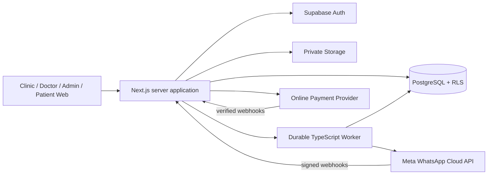

# Technical Architecture Recommendation — Clinic SaaS
**Status:** recommended stack, not a settled product requirement. Validate current package versions at project initialization and comply with local hosting/privacy review.

## Recommendation
**Build a responsive web-first application with Next.js (App Router), React, TypeScript, Tailwind CSS, shadcn/ui, PostgreSQL on Supabase, Supabase Auth/Storage, and a dedicated Node/TypeScript job worker.** Use the official Meta WhatsApp Cloud API behind a provider abstraction. Payment gateway likewise behind an adapter for eligible Egyptian providers (evaluate Paymob/Fawry or other contract-qualified gateways; do not hardwire a provider without verification).

| Layer | Technology | Why |
|---|---|---|
| Application / admin UI | Next.js App Router + React + TypeScript | One responsive clinic/public/platform portal; Claude Code productivity; server-side routes/actions |
| UI | Tailwind CSS + shadcn/ui + Radix primitives | Arabic/RTL-capable, accessible composable UI, easy custom dashboard |
| Forms / schemas | React Hook Form + Zod | Explicit input validation on client/server; typed contracts |
| Server data | TanStack Query where needed; server components appropriately | Cache scoped by authenticated clinic ID; avoid stale cross-tenant data |
| Persistence | Supabase managed PostgreSQL + SQL migrations | Relational integrity, cross-table atomic transactions, strong financial/event modeling |
| Authentication | Supabase Auth | Multi-clinic human identities; login, invite activation, sessions |
| Authorization | PostgreSQL RLS and least-privilege grants, plus server domain policy services | Defense-in-depth; row-level tenant enforcement and doctor visit access policy |
| Files | Private Supabase Storage buckets | Protected licenses, optional receipts/evidence, controlled clinical attachments if later approved |
| Job worker | Separate Node.js/TypeScript worker using `pg-boss` (Postgres-backed durable jobs) | Reliable queued reminders, retries, expirations and webhooks without a second queue datastore; deploy always-on separate from request handler |
| Messaging | Official Meta WhatsApp Cloud API via `MessagingProvider` interface | Authorized templates, message status webhooks, patient interactive replies |
| Payments | `SubscriptionPaymentProvider` interface; gateway selected after contracting | Online + manually verified InstaPay/bank transfer; optional recurring when actually supported |
| Monitoring | Sentry + structured redacted logs + uptime monitoring | Failure alerts without exposing medical content |
| Tests | Vitest, Playwright, Postgres RLS/integration tests | Domain, concurrency, policy and browser regression protection |
| Hosting | Next.js hosted on managed Node environment (e.g. Vercel) + always-on worker on Render/Railway/Fly + Supabase | Separation of interactive workloads vs durable processing; evaluate data residency/legal constraints before selecting region |
| Source control / CI | GitHub + GitHub Actions | Pull requests, lint/typecheck/test/deploy gates |

**Caution:** `pg-boss` requires worker-compatible direct/appropriate pooled Postgres connections and vendor support; validate Supabase connection limits, transaction pooler behavior and managed job-scheduling costs. Alternatives: Supabase Queues/pgmq + scheduled Edge Functions, or managed durable workflows such as Inngest. Choose one after proof-of-concept; do not silently add Redis, Kafka or multiple queue systems.

## Why not FlutterFlow + Firebase for this project?
FlutterFlow remains capable for straightforward front-end forms, but this project requires intricate tenant authorization, multi-actor visit-scoped medical access, atomic financial reversal journals, concurrency-safe bookings, auditable consent and reliable webhook jobs. A code-first relational architecture provides clearer control and is more natural for Claude Code generating source. Firebase can also be made secure, but it increases complexity of some relational invariants. This is a technical recommendation, not a claim that FlutterFlow is unusable.

## Simpler alternative
If vendor independence and bespoke server authorization dominate, use Next.js + NestJS + managed PostgreSQL (with Prisma/Drizzle) + object storage and a durable queue. It offers strong backend modularity but more infrastructure, code, and deployment work than the recommended Next.js + Supabase setup. Avoid adding NestJS prematurely unless backend workflows require a separately deployed API or multiple client apps.

## Architecture diagram


## Important implementation choices
1. **Module boundaries:** Identity/Tenancy, Clinic & Licensing, Patient Registry, Scheduling & Queue, Clinical Records & Consent, Finance & Accounting Journal, Messaging, Billing & Entitlements, Audit & Compliance, Platform Admin.
2. **Data access:** database functions/transactions for critical operations (confirm slot, next queue no., complete visit, approve opening balance, post refund/reversal, limit reservation, consume WhatsApp credits). Never implement concurrent checks as read-then-write from browser.
3. **RLS architecture:** per-row clinic membership checks; doctor-visit authorization for medical content; explicit prohibition of generic clinic-wide clinical SELECT. Client service key only publishable and behind policies; privileged secret only in trusted server runtime, narrowly scoped. Test both grants and policies.
4. **Medical authorization:** prefer separate sensitive tables/schema plus policy functions verifying assigned visit/consent state and expiry on every fetch. Cross-clinic read gateway returns least necessary fields and has no export endpoint; logging redacted.
5. **Monetary model:** integer minor units, currency EGP, immutable postings, linked reversal/refund relations, transactional reports based on posted movements, distinct doctor-linked collection analytics.
6. **Appointments:** transaction-safe capacity/slot assignment, date/time exceptions, separate queue reservation vs check-in waiting numbers, authorized overbooking states.
7. **Scheduled communication:** `message_intent` + outbox; idempotency keys; worker verifies current appointment status, consent, template approval, language, budget and connectivity immediately before dispatch. Store retries and status webhooks independently.
8. **SaaS trial & billing:** subscription snapshots by plan version; entitlements evaluated server-side; request upgrade effective at `next_renewal_at`; manual receipt evidence review; webhooks signed and idempotent.
9. **Tenancy:** active clinic selector is a *view context*, not authority. API verifies membership regardless of selected UI clinic; cache key prefixes clinic_id; logout/switch clears protected cached data.
10. **Audit:** append-only event log with actor/user, clinic, resource, action, outcome, timestamp, request id, secure minimal metadata. Separate sensitive access logs from sensitive record bodies.

## Suggested folder structure
```
app/
  (public)/ (auth)/ (clinic)/ (doctor)/ (platform-admin)/ api/
components/ ui/ clinic/ forms/
modules/
  identity/ tenancy/ onboarding/ patients/ appointments/ queue/
  clinical/ consent/ finance/ messaging/ billing/ audit/ platform-admin/
lib/
  auth/ permissions/ validation/ db/ time/ telemetry/ integrations/
worker/
  jobs/ handlers/ providers/
supabase/
  migrations/ tests/ seed.sql
packages/ (only if truly needed)
tests/
  integration/ e2e/ security/ contracts/
docs/
```

## Environments and release gates
- Local dev: Supabase local or dedicated sandbox, mock WhatsApp and payment provider, synthetic data only.
- Staging: dedicated projects/accounts with gateway and Meta sandbox/test connections.
- Production: separate credentials, service principals, consent/legal texts, verified template approvals, encrypted backups incl. file objects, emergency rollback and restore testing.
- CI: format/lint/typecheck, unit tests, RLS tests, integration tests, Playwright smoke, build and secret scanning.
- Production launch must be blocked on Egyptian legal review of sensitive medical processing, contractual data-hosting/transfer policies and invoice issuance obligations.

## Sources / authoritative references
- Supabase RLS/grants: https://supabase.com/docs/guides/database/postgres/row-level-security
- Supabase database and backups: https://supabase.com/docs/guides/database/overview
- Supabase storage access: https://supabase.com/docs/guides/storage/security/access-control
- Supabase security: https://supabase.com/docs/guides/database/secure-data
- WhatsApp Business API webhooks: https://www.postman.com/meta/whatsapp-business-platform/folder/tduohwq/webhook-payload-reference
- Claude Code project context: https://support.claude.com/en/articles/14553240-give-claude-context-claude-md-and-better-prompts
